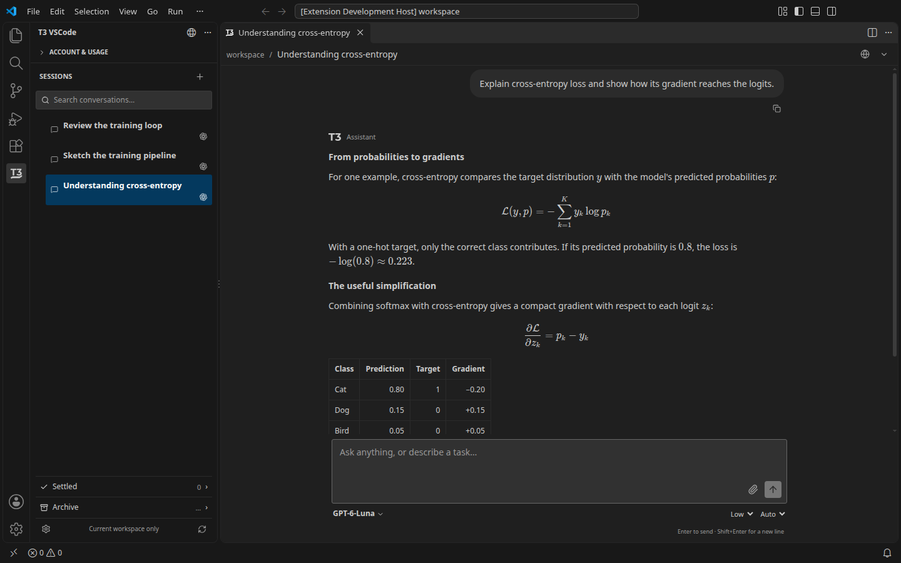
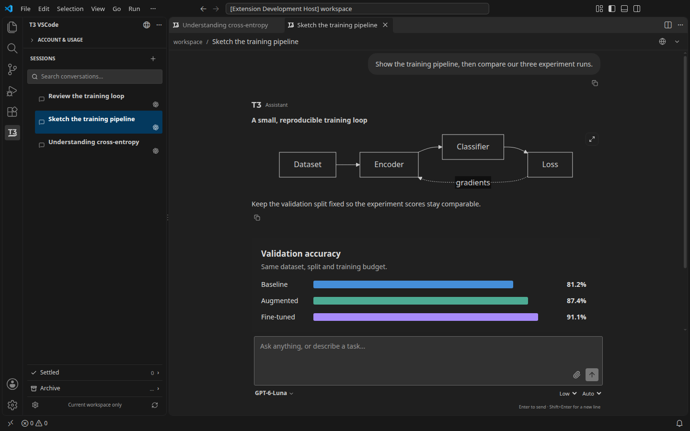
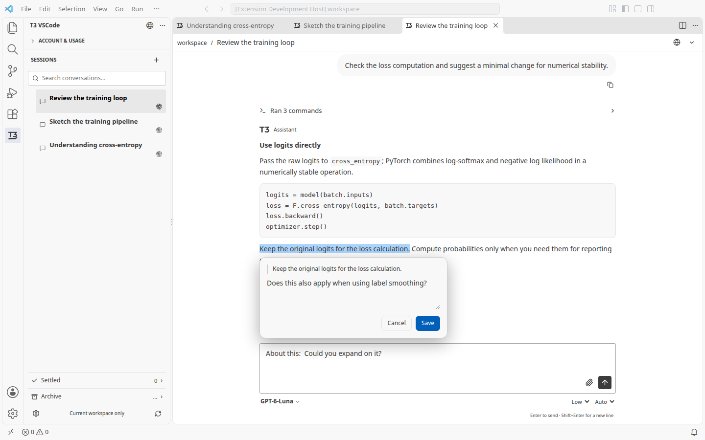

# T3 VSCode

A VS Code client for a separately running [T3 Code](https://github.com/pingdotgg/t3code) server: workspace sessions and agent chat in editor tabs, beside your code instead of in a browser. Colors follow your VS Code theme.

0.2.4 is on the [Marketplace](https://marketplace.visualstudio.com/items?itemName=hungtienhuang.t3-vscode) release channel.

## In the editor

Captured from the extension in an isolated VS Code window with synthetic conversations.

*Sessions beside the conversation. Equations, tables and code render in the editor tab.*

*A response's agent-only changes, opened in VS Code's read-only diff editor.*

*Find in session searches the whole recorded conversation.*

*Any model the server advertises, with its effort and permission mode.*

*Mermaid diagrams and T3 HTML graphics render in the transcript.*

*Scheduled tasks get their own model, effort and schedule.*

*Quote a passage and comment on it; the reference lands at your prompt cursor.*

## What you get

| | |
| --- | --- |
| Sessions | Workspace-scoped projects, threads and subagents; rename, pin, settle, archive. |
| Editor tabs | One conversation per tab, each with a durable draft and its own History picker. |
| Rich transcripts | Markdown, code, tables, images, media, Mermaid, T3 HTML graphics, KaTeX math. |
| Code-aware prompts | Ctrl/Cmd+K inserts a file reference; **Cite** quotes a reply; `@` files, `/` commands. |
| Agent control | Server models, effort and permission modes, Stop, queue and steer, approvals. |
| Review | Agent-only response diffs in VS Code's diff editor; full-history **Find in session**. |
| Usage and tasks | Status-bar account meters; a Tasks tab for T3 scheduled work. |

## Get started

T3 Code and its providers are separate applications you install and run yourself.

1. Install the T3 Code CLI — [installation guide](https://github.com/pingdotgg/t3code/blob/main/docs/user/install.md).
2. Run `t3`, then connect a provider under **Settings → Providers**.
3. In VS Code, open the **T3 VSCode** view and choose **Retry connection**.

Pairing is automatic. Running T3 as a [background service](https://github.com/pingdotgg/t3code/blob/main/docs/user/background-service.md) is optional; if connection fails, **Connection details** names the failed stage.

## Scope and limitations

- Alpha. Linux is the first verified platform.
- Local servers only; remote T3 servers are not supported yet.
- Specialized tool previews and interactive checkpoint restore remain later work; rendering is not full web-app parity.
- No embedded terminal, and moving a chat between windows is unverified.

## More

- [User guide](docs/user-guide.md) — setup, every setting, how each feature behaves.
- [Feature history](docs/feature-history.md), [changelog](CHANGELOG.md) — what changed, by version.
- [Development and testing](docs/development.md) — build, debug, verify.
- [Publishing](docs/publishing.md) — version policy and release procedure.
- [Support](SUPPORT.md) — reporting bugs.

### Documentation map

The user guide is authoritative for current feature behavior; the feature history is authoritative for when each behavior shipped and for in-progress/unreleased work; the architecture doc is authoritative for the host/webview design and milestones. `docs/mockups/*` are design explorations made before or during implementation, not records of current behavior — each mockup file says whether and how it was implemented.

[MIT licensed](LICENSE). T3-derived code keeps [its upstream notice](vendor/LICENSE.t3code); bundled dependencies keep their own.
